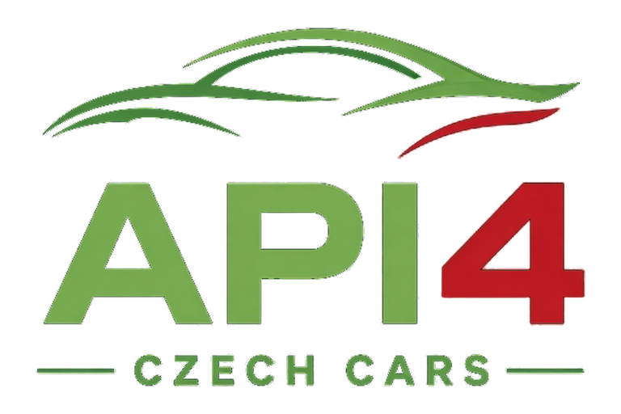

  

# API 4 Czech Cars (public API) pro Home Assistant

Integrace Home Assistantu pro připojená vozidla ŠKODA postavená na oficiálním
[MyŠkoda Public API](https://public.api.connect.skoda-auto.cz/docs). English: [README.md](README.md).

> **Neoficiální komunitní projekt.** Nemá žádné spojení se společností ŠKODA AUTO a.s., koncernem Volkswagen,
> Home Assistantem ani HACS. Příkazy ovládají skutečné vozidlo – před použitím si přečti
> [UPOZORNĚNÍ](DISCLAIMER.md) (včetně bezpečnostních pokynů).

## Funkce
Z podporovaných jednoduchých hodnot, které API vrátí, vznikají entity (nová pole se objevují automaticky podle výbavy vozidla):

| Platforma | Co dostaneš |
|---|---|
| `sensor` | Stav baterie, **dojezd (km)**, tachometr, palivo, stav a nastavení nabíjení, nabíjecí profily, klimatizace, stav dveří/oken/světel … (jednotky a třídy zařízení se odvozují z názvů polí) |
| `binary_sensor` | Všechna pole ano/ne (např. zamčené dveře), **nabíjení baterie** |
| `device_tracker` | Poloha parkování |
| `switch` | Start/stop nabíjení, přídavné topení, aktivní větrání |
| `number` | Limit nabití (50–100 %, krok 10) |
| `climate` | Zapnutí/vypnutí klimatizace a cílová teplota |
| diagnostika | Zbývající požadavky API, platnost API klíče, vynechané části dat |

Ovládací entity se zobrazí jen tehdy, když vozidlo příslušnou funkci hlásí. Stav baterie a ikona nabíjení jsou
nahoře na stránce zařízení.

Služba `skoda_public.request` pošle libovolný požadavek na `/api/v1/vehicles/{vin}{path}` (např. pro funkce bez
vlastní entity).

## Požadavky
- Home Assistant **2026.3.0** nebo novější (obrázky značky jsou součástí integrace).
- Vozidlo ŠKODA s aktivní službou MyŠkoda a **API klíč MyŠkoda** pro toto vozidlo
  (vytvoříš ho v aplikaci MyŠkoda: <https://go.skoda.eu/api-keys>).

## Instalace

### HACS (vlastní repozitář)
1. HACS → ⋮ → **Vlastní repozitáře**.
2. Repozitář: `https://github.com/JS-CODE-LAB/api4-czech-cars`, typ **Integrace** → Přidat.
3. V HACS najdi **API 4 Czech Cars (public API)** → **Stáhnout**.
4. Restartuj Home Assistant.

### Ručně
Zkopíruj `custom_components/skoda_public` do `<config>/custom_components/` a restartuj.

## Nastavení
Nastavení → Zařízení a služby → **Přidat integraci** → *API 4 Czech Cars (public API)*, zadej API klíč a VIN.
Každé vozidlo se přidává zvlášť.

### Možnosti
| Možnost | Význam |
|---|---|
| Interval aktualizace | Sekundy mezi dotazy (výchozí 600, minimum 300). |
| Klimatizace bez externího napájení | Povolí start klimatizace, i když auto není zapojené (u nových instalací výchozí hodnota vypnuto). |
| Délka přídavného topení | Doba běhu topení v sekundách (výchozí 600). |
| S-PIN | API ho vyžaduje pro přídavné topení. Home Assistant ho ukládá nešifrovaně. |

## Dobré vědět
- **Limit:** API povoluje zhruba 20 požadavků za hodinu na vozidlo. Každý příkaz navíc vyvolá jedno obnovení
  stavu asi za 30 s.
- **Teplota klimatizace:** API neumí nastavit jen teplotu. Při vypnuté klimatizaci se změna cíle jen uloží v HA
  a použije se při dalším zapnutí. Při běžící klimatizaci se odešle nový start.
- **Vozidlo může příkaz odmítnout** (nepodporuje, je offline, nízká baterie …); důvod se zobrazí v HA.
- Jako entity chybí změna režimu nabíjení a úprava nabíjecích profilů (použij službu).
- Rozsah dat závisí na vozidle; nepodporované části API vynechá.

## Bezpečnost dálkového ovládání a pokročilá služba

**Příkazy ovládají skutečné vozidlo.** Před zapnutím nabíjení, klimatizace, větrání nebo přídavného topení ověřte bezpečné okolí vozidla. Nikdy nespouštějte palivové topení ani motor v uzavřené garáži. Příkazy mohou být odmítnuty nebo provedeny se zpožděním. Integrace není určena pro bezpečnostně kritické automatizace.

Akce `skoda_public.request` je **pokročilé rozhraní pro obecné požadavky na API vozidla**. Uživatelé s příslušným přístupem mohou odesílat příkazy a čerpat limit API. Automatizace ji mohou spouštět bez dalšího potvrzení. Chraňte přístup k Home Assistantu a přihlašovací údaje.

## Řešení potíží
- *Chyba ověření / opětovné ověření:* API klíč vypršel nebo nepatří k VINu – vytvoř nový a zadej ho, až se HA zeptá.
  Diagnostický senzor *API key expires at* pomůže klíč obnovit včas.
- *Příliš mnoho požadavků (429):* zvyš interval aktualizace.
- Chyby nahlašuj v [Issues](../../issues) a předtím **odstraň VIN, API klíč, S-PIN a GPS polohu**.

## Soukromí
Data putují jen mezi tvým Home Assistantem a API společnosti ŠKODA. Žádná telemetrie. Přihlašovací údaje a S-PIN
jsou v konfiguraci Home Assistantu (nešifrovaně, součástí záloh). Poloha vozidla se ukládá do historie HA, pokud ji
nevyřadíš.

## Poděkování
Podrobnosti o endpointech jsem ověřoval podle open-source knihovny
[skoda-public-api](https://github.com/mobility-lab-vsb/skoda-public-api) a oficiální dokumentace API.
Žádný její kód není součástí integrace.

## Podmínky API a licence
[Oficiální dokumentace MyŠkoda Public API](https://public.api.connect.skoda-auto.cz/docs) výslovně omezuje použití API na **osobní použití koncovými uživateli** a vylučuje komerční produkty a služby. Licence MIT se vztahuje na vlastní kód integrace, **nikoliv na oprávnění komerčně využívat API ŠKODA**. Uživatel musí dodržovat aktuální podmínky API. Dostupnost, datová pole a limity API se mohou měnit.

## Licence
[MIT](LICENSE) – viz také [UPOZORNĚNÍ](DISCLAIMER.md). Ochranné známky patří jejich vlastníkům.

## Organizace entit ve verzi 0.3.1

Entity jsou přiřazeny k virtuálním podřízeným zařízením hlavního vozidla: Baterie, Nabíjení, Nabíjecí profily, Klimatizace a topení, Dveře a zámky, Okna, Osvětlení, Počítadla a spotřeba, Pohon a palivo, Poloha a parkování, Nastavení, Informace o vozidle, Ostatní stavy vozidla a Diagnostika. Zobrazují se jen skupiny obsahující dostupné entity. **Aktuální dojezd (Range, km) je ve skupině Počítadla a spotřeba společně s odometrem.**

Původní `unique_id` entit zůstávají zachována, mění se však jejich přiřazení k zařízení. Po aktualizaci zkontrolujte automatizace, skripty a dashboardy odkazující na původní zařízení. Entity kvůli přesunu nemažte ani znovu nevytvářejte.

### Aktualizace ze starších verzí
1. Vytvořte zálohu Home Assistantu včetně registru entit a automatizací.
2. Aktualizujte integraci a restartujte Home Assistant.
3. Zkontrolujte podřízená zařízení, původní ID entit a automatizace používající zařízení.
4. V Diagnostice ověřte poslední aktualizaci a případné chyby API.

## Lokalizace a obrázky (0.3.2)

V českém prostředí Home Assistantu se nové názvy entit zobrazují česky. Pevně definované entity používají překlady Home Assistantu, dynamicky objevené hodnoty používají české popisky částí API. Neznámé názvy polí mohou obsahovat původní technické označení. Jazyk nově vytvářených názvů vychází z jazyka **serveru Home Assistant**, nikoliv jen z jazyka prohlížeče.

Odkazy na obrázky vozidla vrácené API se zobrazují jako entity typu **image**, nikoli textové senzory. Změna domény entity může ovlivnit dashboardy a automatizace, které používaly původní `sensor.*` s URL. Zkontrolujte je po aktualizaci. Původní názvy upravené ručně v registru entit Home Assistant automaticky nepřepisuje. Pokud název zůstane anglický, zkontrolujte vlastní název entity a jazyk Home Assistantu.
